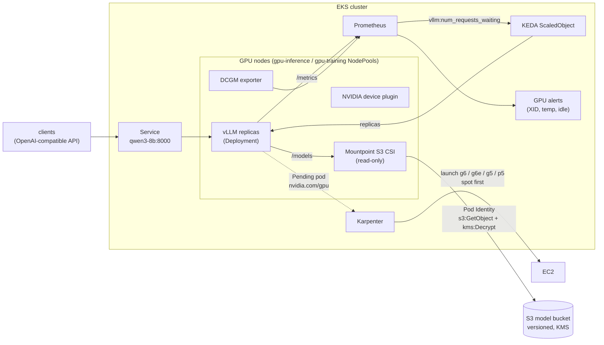

# terraform-aws-eks-ai-cluster

[](https://github.com/ozy31/terraform-aws-eks-ai-cluster/actions/workflows/ci.yml)


Terraform modules that turn an existing Amazon EKS cluster into a GPU platform for
LLM inference: Karpenter GPU NodePools, the NVIDIA device plugin and DCGM metrics,
model weights in S3 mounted read-only through Mountpoint, and vLLM model servers that
scale on request queue depth with KEDA.

It sits on top of [terraform-aws-eks-platform](https://github.com/ozy31/terraform-aws-eks-platform)
(VPC, EKS, Karpenter, KEDA) and [k8s-observability-stack](https://github.com/ozy31/k8s-observability-stack)
(Prometheus, Grafana, Alertmanager). Those repos build the cluster; this one adds GPUs and models.

## Contents

- [Architecture](#architecture)
- [Modules](#modules)
- [How a request scales the cluster](#how-a-request-scales-the-cluster)
- [Usage](#usage)
- [Design decisions](#design-decisions)
- [Cost notes](#cost-notes)
- [Operations](#operations)
- [Development](#development)

## Architecture



## Modules

| Module | What it creates |
|---|---|
| [`gpu-nodepools`](modules/gpu-nodepools) | One `EC2NodeClass` (NVIDIA AMI via alias, IMDSv2 hop limit 1, encrypted gp3, local NVMe in RAID0) and a Karpenter `NodePool` per entry in `node_pools`. Every pool is tainted `nvidia.com/gpu=true:NoSchedule`, labelled `ai.platform/pool=<name>` and capped with an `nvidia.com/gpu` limit. |
| [`gpu-stack`](modules/gpu-stack) | NVIDIA device plugin (optional time-slicing), DCGM exporter with a ServiceMonitor, and a `PrometheusRule` with recording rules plus XID, temperature, memory, missing-exporter and idle-GPU alerts. |
| [`model-store`](modules/model-store) | Versioned S3 bucket with SSE-KMS (bucket key on), TLS-only policy, lifecycle for old versions; the Mountpoint for Amazon S3 CSI driver as an EKS add-on with a read-only Pod Identity role. |
| [`inference`](modules/inference) | A vLLM OpenAI-compatible server: Deployment, Service, PDB, static Mountpoint PV/PVC, KEDA `ScaledObject` on queue depth, ServiceMonitor. One module call per model. |

[`examples/complete`](examples/complete) wires all four together and serves two models:
an 8B model on a single L4/A10G GPU and a 32B FP8 model sharded across four GPUs with
scale-to-zero.

## How a request scales the cluster

1. Traffic rises; vLLM's continuous batching fills up and requests start to queue.
   `vllm:num_requests_waiting` goes above `waiting_per_pod`.
2. KEDA raises the Deployment's replica count (one pod per two minutes, so a new replica
   can warm up before the next is added).
3. The new pod requests `nvidia.com/gpu` and tolerates the GPU taint. No node fits, so it
   is Pending.
4. Karpenter picks the cheapest instance in the pool that fits (spot first), launches it
   from the NVIDIA AMI and registers it.
5. The device plugin advertises the GPUs, the pod starts, Mountpoint streams the weights
   from S3, vLLM loads them and the startup probe passes. The Service adds the endpoint.
6. When the queue drains, KEDA scales back down after the stabilization window, and
   Karpenter consolidates the empty or underutilized GPU node away after `consolidate_after`.

## Usage

```hcl
module "gpu_nodepools" {
  source = "github.com/ozy31/terraform-aws-eks-ai-cluster//modules/gpu-nodepools?ref=v0.1.0"

  cluster_name   = "prod-euw1"
  node_role_name = module.karpenter.node_iam_role_name
}

module "gpu_stack" {
  source = "github.com/ozy31/terraform-aws-eks-ai-cluster//modules/gpu-stack?ref=v0.1.0"

  depends_on = [module.gpu_nodepools]
}

module "model_store" {
  source = "github.com/ozy31/terraform-aws-eks-ai-cluster//modules/model-store?ref=v0.1.0"

  cluster_name = "prod-euw1"
}

module "qwen3_8b" {
  source = "github.com/ozy31/terraform-aws-eks-ai-cluster//modules/inference?ref=v0.1.0"

  name = "qwen3-8b"
  model = {
    s3_prefix   = "qwen/Qwen3-8B"
    served_name = "qwen3-8b"
  }
  model_bucket = {
    name   = module.model_store.bucket_name
    region = module.model_store.bucket_region
  }
}
```

Publish a model, then call it:

```bash
huggingface-cli download Qwen/Qwen3-8B --local-dir ./Qwen3-8B
aws s3 sync ./Qwen3-8B "s3://$(terraform output -raw model_bucket)/qwen/Qwen3-8B/"

kubectl -n inference port-forward svc/qwen3-8b 8000:8000
curl -s localhost:8000/v1/chat/completions \
  -H 'content-type: application/json' \
  -d '{"model":"qwen3-8b","messages":[{"role":"user","content":"Hello"}]}'
```

**Prerequisites in the cluster:** Karpenter v1, KEDA, and the Prometheus Operator CRDs
(kube-prometheus-stack). The [`terraform-aws-eks-platform`](https://github.com/ozy31/terraform-aws-eks-platform)
and [`k8s-observability-stack`](https://github.com/ozy31/k8s-observability-stack) repos provide all three.

## Design decisions

**Scale on queue depth, not GPU utilization.** vLLM keeps the GPU busy and pre-allocates
memory for KV cache, so utilization and memory sit high whether the server is coping or
not. Requests waiting in the scheduler queue is the signal that users are about to see
latency. Both metrics are still collected for dashboards and cost alerts.

**Taint every GPU node.** Without the taint a DaemonSet-heavy cluster or a careless
Deployment will happily schedule CPU pods onto a $30/hour p5 and keep it alive.
Only pods that explicitly tolerate `nvidia.com/gpu` and select a pool land there.

**Pools per workload shape, not per instance type.** `inference` is spot-first across
g6, g6e and g5 so Karpenter can find capacity when one family is short; `training` is
on-demand p5/p4d with `WhenEmpty` consolidation and a zero disruption budget, so a running
job is never moved to save money. Each pool has its own `nvidia.com/gpu` limit as the
hard cost ceiling.

**Weights from S3 through Mountpoint instead of baking them into images.** Images stay
small and model-agnostic, one bucket serves every cluster in the region, versioning gives
rollback, and the CSI driver holds the read-only credentials so model pods have no AWS
permissions at all (`automountServiceAccountToken: false`). Instance-store RAID0 gives the
container runtime and caches fast local disk.

**Slow, careful rollouts.** `maxSurge: 1, maxUnavailable: 0`, a 30-minute startup probe
budget, a PDB of one, disruption budgets of one node, and a 15-second preStop so the
Service drops a pod before in-flight generations are cut. GPU replicas take minutes to
start, so rollouts are deliberately slow.

**Scale-to-zero is opt-in and needs a wake signal.** A scaled-to-zero vLLM exports no
metrics, so the queue trigger can never wake it. `min_replicas = 0` is rejected unless
`wake_query` points at an upstream request counter (gateway or ingress).

**AL2023 NVIDIA AMI by default.** Drivers come with the AMI; the device plugin is a
Helm release so time-slicing and upgrades are managed in Terraform. On Bottlerocket set
`node_os = "bottlerocket"` and `install_device_plugin = false`, since the `-nvidia`
variant ships the plugin in the host image.

**Time-slicing keeps the `nvidia.com/gpu` name.** Renaming shared GPUs to
`nvidia.com/gpu.shared` is safer on a static cluster, but Karpenter cannot provision for an
extended resource it does not know, so pods would stay Pending.

## Cost notes

- Spot g6/g5 is typically 60–70% cheaper than on-demand. vLLM replicas are stateless,
  and Karpenter receives the two-minute interruption notice through SQS
  (from terraform-aws-eks-platform), cordons and drains the node, and the PDB plus
  `maxSurge` bring up a replacement.
- `GPUIdle` fires when a node's GPUs sit below 5% for two hours. Usually it means
  `min_replicas` is higher than traffic needs.
- `max_gpus_per_node` keeps Karpenter from bin-packing two small replicas onto an
  8-GPU instance that later cannot be consolidated.
- Prefix caching (`--enable-prefix-caching`) and FP8 weights fit more concurrent requests
  on the same GPU, which is the cheapest scaling there is.

## Operations

| Situation | What to do |
|---|---|
| `GPUXidError` with a hardware-class XID (48, 63, 64, 74, 79, 92–95) | `kubectl cordon <node>` then `kubectl delete nodeclaim <name>`; Karpenter replaces it and the PDB keeps one replica at a time moving. |
| New model version | `aws s3 sync` to a new prefix, change `s3_prefix`, apply. The rollout starts the new replica before stopping the old one. Roll back by reverting the variable. |
| Pod stuck Pending | `kubectl get nodeclaims` and Karpenter logs: usually the pool's `gpu_limit` is reached or no instance family in the pool has capacity in the AZs. |
| Node image update | Pin `ami_alias_version`; bumping it marks nodes drifted and Karpenter replaces them one at a time within the disruption budget. |

## Development

```bash
make check      # fmt-check, validate, tflint, helm lint, promtool, trivy
make charts     # helm lint + render every local chart
make rules      # render the GPU PrometheusRule and run promtool check rules
```

CI runs the same steps on every push and pull request.

## License

MIT
